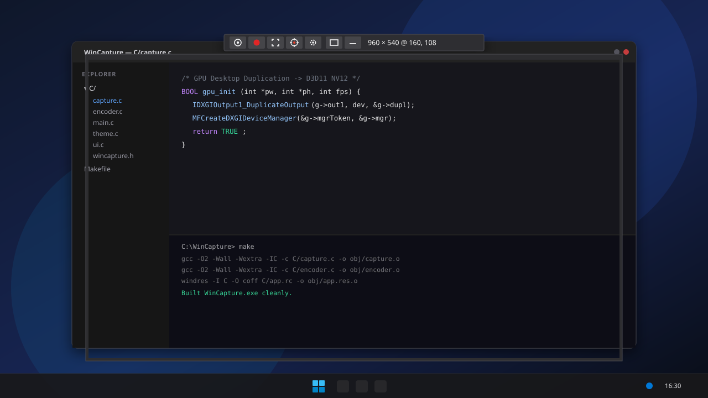
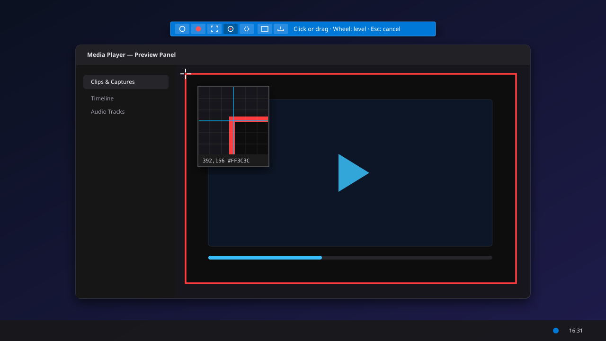
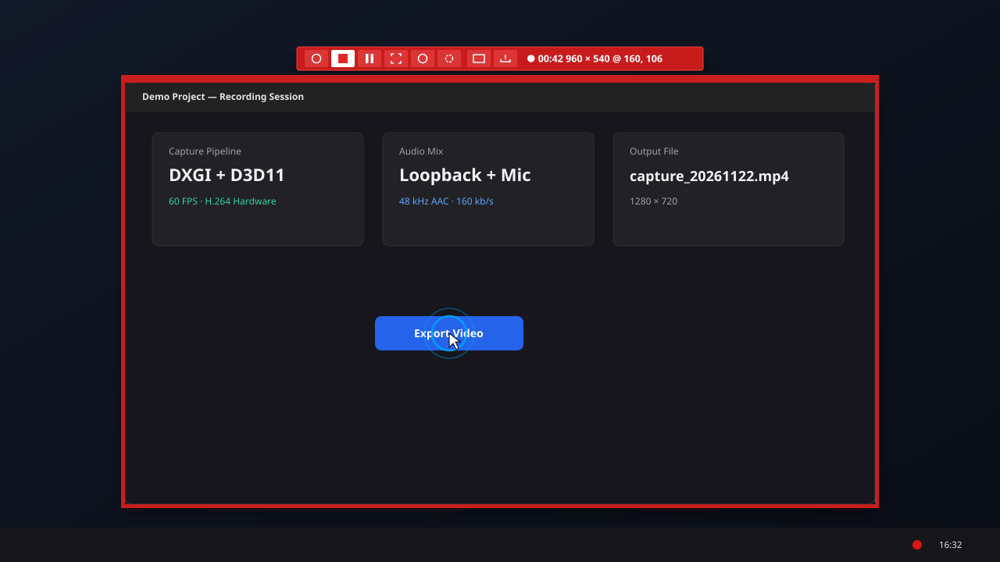
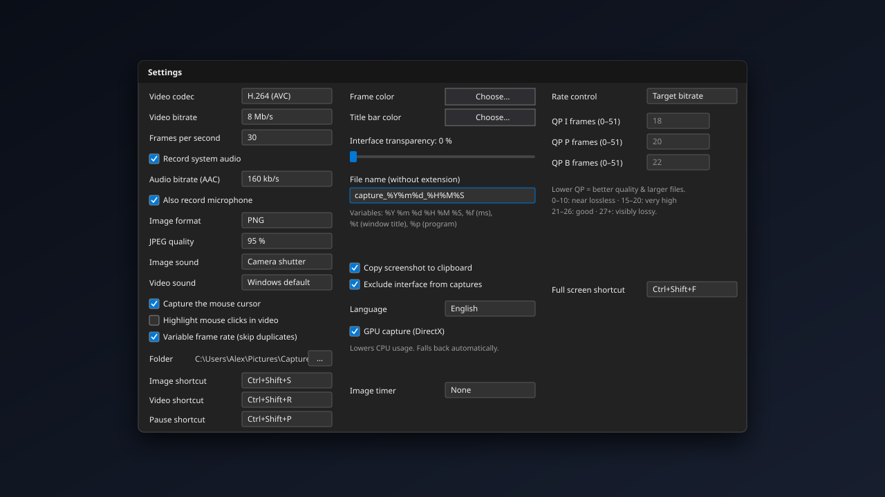

# WinCapture

A lightweight, dependency-free **Win32 screen & audio capture tool** written in pure C. WinCapture combines a compact floating toolbar and resizable hollow capture frame with hardware-accelerated **DXGI/Direct3D 11** capture, **Media Foundation** H.264/HEVC encoding, **WASAPI** system + microphone audio mixing, **UI Automation** window targeting with a **4× pixel magnifier**, and automatic **Windows Dark/Light** theme support.

---

## Screenshots

### 1. Floating Toolbar & Hollow Capture Frame
The compact floating bar collapses to Screenshot & Record buttons when idle and expands on hover to show size presets, window targeting, settings, frame toggle, tray minimize, and live region dimensions (`W × H @ X, Y`).



### 2. Window / UI Element Targeting & 4× Pixel Magnifier
Powered by Win32 + UI Automation, the targeter highlights windows and inner UI panels as you move the cursor. Scroll the mouse wheel to step through nesting levels, click to snap the frame, or click-and-drag a custom area—assisted by a real-time **4× pixel loupe** with crosshair coordinates and RGB readout.



### 3. Active Video Recording & Click Highlights
During recording, the frame and bar turn crimson (amber when paused) with a live elapsed timer, Pause/Resume button, and optional circular click-highlight rings rendered directly into the video.



### 4. Settings (Windows Dark / Light Theme)
The settings window automatically follows your Windows `AppsUseLightTheme` preference in real time, including dark title bars and dark-mode controls.



---

## Features

### Screen & Window Capture
- **Resizable Hollow Capture Frame**: Drag the top border handle to move, drag any edge or corner to resize, or snap magnetically to monitor and taskbar work-area edges (hold `Ctrl` while dragging to disable snapping).
- **Pixel-Precise Keyboard Control**: While the toolbar is focused, use the arrow keys to fine-tune the capture region:
  - `Arrow keys`: Move frame by `1 px` (`Shift + Arrow`: `10 px`)
  - `Ctrl + Arrow keys`: Resize frame by `1 px` (`Ctrl + Shift + Arrow`: `10 px`)
- **UI Automation Targeter + 4× Magnifier**: Target full windows, child controls, or UI Automation elements; scroll the wheel to change hierarchy depth, or drag to define a free-form rectangle.
- **Frameless & Full-Screen Modes**: Double-click the toolbar (or click the frame icon) to hide the border while keeping its region, or switch to Full Screen to capture the entire monitor containing the region.
- **Exclude Interface from Captures**: Enabled by default via `SetWindowDisplayAffinity` (`WDA_EXCLUDEFROMCAPTURE`) so WinCapture's own overlay never appears in your screenshots or videos.
- **Per-Monitor V2 DPI Awareness**: Scales crisply across mixed-DPI multi-monitor setups (`app.manifest` + `WM_DPICHANGED`).

### Video Recording & Encoding
- **H.264 (AVC) & H.265 (HEVC)** output to **`.mp4`** via Windows Media Foundation (`IMFSinkWriter`).
- **GPU-Accelerated Pipeline**: Captures frames directly via **DXGI Desktop Duplication** and converts BGRA → NV12 on the GPU using **D3D11 `VideoProcessor`**, feeding hardware encoders with minimal CPU overhead (automatically falls back to GDI if unavailable).
- **Rate Control Modes**:
  - **Target Bitrate**: `2`, `4`, `8`, `16`, or `32 Mb/s`
  - **Constant Quality (QP)**: Independent `QP` (`0–51`) for `I`, `P`, and `B` frames via `ICodecAPI`
- **Frame Rates & VFR**: `15`, `24`, `30`, or `60 FPS`, with optional **Variable Frame Rate (VFR)** to skip duplicate frames when screen content is static.
- **Pause / Resume**: Pause and resume recordings seamlessly without splitting files.
- **Cursor & Click Effects**: Optional mouse cursor capture and animated click-ripple halos (blue for left-click, orange for right-click).

### Audio Capture
- **System Audio (Loopback)** via WASAPI shared-mode capture.
- **Optional Microphone Input** mixed in real time with system audio and resampled automatically to `44.1 kHz` or `48 kHz` **AAC** (`96`, `128`, `160`, or `192 kb/s`).
- **Clean Start/Stop Cues**: Audio capture automatically mutes the duration of WinCapture's own start/stop notification sound so it never leaks into your recording.

### Screenshots
- **Formats**: **PNG**, **JPEG** (adjustable quality `60%–100%`), and **BMP** via Windows Imaging Component (WIC).
- **Countdown Timer**: Optional `3 s`, `5 s`, or `10 s` delay displayed directly on the shutter button and status bar.
- **Clipboard & Quick Actions**: Automatically copies screenshots to the clipboard (`CF_DIB`), with system tray shortcuts to open the captures folder, open the last file, or copy the last screenshot again.

### Customization, Naming & Localization
- **Size & Position Presets**: Includes `360p`, `480p`, `720p (HD)`, `1080p (Full HD)`, `1440p (2K)`, and `2160p (4K)` presets, plus a full preset editor supporting saved `(X, Y)` screen positions.
- **Dynamic File Name Templates**: Customize output stems (default `capture_%Y%m%d_%H%M%S`) using variables:
  - `%Y`, `%y`, `%m`, `%d`, `%H`, `%M`, `%S`, `%f` — Date, time, and milliseconds
  - `%t` — Title of the window under the capture center
  - `%p` — Process name of the captured application
- **Global Hotkeys** (customizable in Settings):
  - Screenshot: `Ctrl + Shift + S`
  - Record / Stop Video: `Ctrl + Shift + R`
  - Pause / Resume: `Ctrl + Shift + P`
  - Full Screen: `Ctrl + Shift + F`
- **Appearance**: Custom frame and title bar colors, adjustable interface opacity (`0%–80%`), and automatic Windows Dark/Light mode support.
- **Multilingual UI**: **English**, **Français**, **Español**, and **Deutsch** (auto-detected on first launch, stored alongside all settings in `capture.ini`).

---

## Building from Source

### Prerequisites
- **Windows 10 / 11** (64-bit or 32-bit)
- **MinGW-w64** toolchain (`gcc`, `windres`) and GNU `make` (via MSYS2, WinLibs, w64devkit, etc.)
- **Linux build host (optional):** MinGW-w64 cross-compiler (`x86_64-w64-mingw32-gcc`, `x86_64-w64-mingw32-windres`); Wine is needed only for `make run`.
- No external third-party libraries are required — WinCapture links solely against standard Windows system libraries (`mfplat`, `mfreadwrite`, `mfuuid`, `windowscodecs`, `d3d11`, `dxgi`, `dwmapi`, `uiautomation`, `comctl32`, etc.).

### Compile & Run
```bat
make
```
This compiles all object and resource files into `obj/` and produces `WinCapture.exe` at the project root.
On Linux, `make` uses the MinGW-w64 cross-compiler by default to produce a Windows executable; it does not build a native Linux application.

Available `Makefile` targets:
- `make` / `make all` — Build `WinCapture.exe`
- `make run` — Build if needed and launch `WinCapture.exe`
- `make clean` — Remove the `obj/` directory
- `make fclean` — Remove `obj/` and `WinCapture.exe`
- `make re` — Clean rebuild (`fclean` + `all`)

---

## Project Structure

```text
.
├── C/
│   ├── main.c         # Entry point (wWinMain), INI config, file naming, clipboard, sound synthesis
│   ├── capture.c      # WIC screenshots, GDI & DXGI/D3D11 video capture, UIA picker & 4x magnifier
│   ├── encoder.c      # Media Foundation H.264/HEVC sink, ICodecAPI QP, WASAPI loopback + mic mixer
│   ├── theme.c        # Windows Dark/Light theme detection, DWM attributes & custom control painting
│   ├── ui.c           # Floating bar, hollow frame, RLE/GDI icons, tray menu, presets & settings UI
│   ├── wincapture.h   # Shared types, GUIDs, localization table & module interfaces
│   ├── app.rc         # Win32 resource script embedding the application manifest
│   └── app.manifest   # Common Controls v6, PerMonitorV2 DPI awareness & OS compatibility
├── docs/
│   └── screenshots/   # Usage screenshots
└── Makefile           # Cross-shell (Windows cmd.exe & POSIX) MinGW build configuration
```
